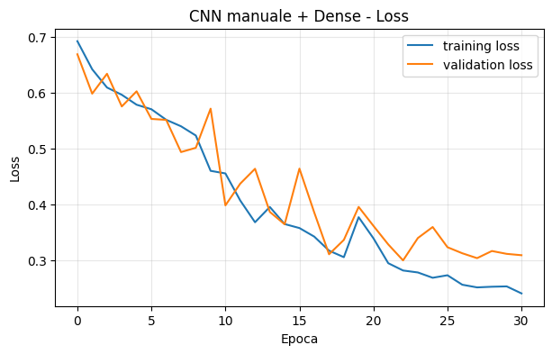
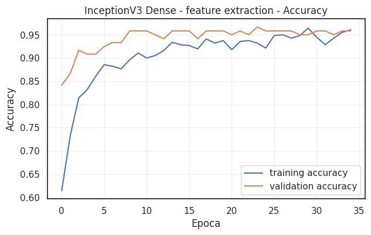
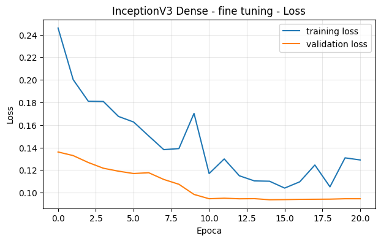
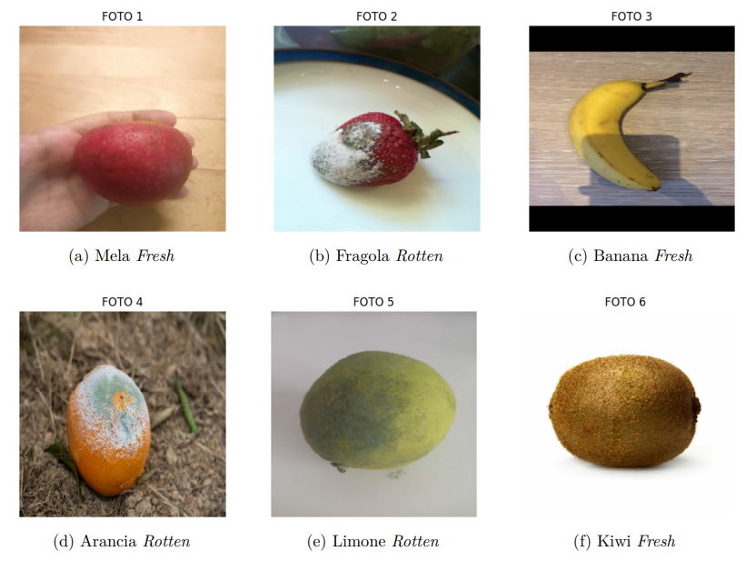

::: {.project-links}
[<i class="bi bi-file-earmark-pdf"></i> Report Completo (PDF)](/assets/FRUIT/Report_Fruits.pdf){.btn-proj-secondary target="_blank"}
:::

::: {.exec-summary}
### IN SINTESI:
In questo progetto di gruppo sviluppiamo una pipeline di **Image Recognition** per la classificazione binaria (**Fresh** vs **Rotten**) mirata a individuare muffa e marciume indipendentemente dal tipo di frutto.

Su un dataset costruito manualmente di 800 immagini (banane, fragole, mele e pere) confrontiamo 7 architetture: due estrattori di feature (**CNN manuale** vs **InceptionV3** pre-addestrata su ImageNet) combinati con tre classificatori (**Dense Layer**, **KNN**, **SVM**), più un modello benchmark con **Fine-Tuning**.

**I Risultati chiave:**

* **Modello migliore (`InceptionV3 Fine-Tuned + Dense`):** raggiungendo un'**accuracy del 97,50%** sul test set (solo **3 errori su 120 immagini**).
* **Impatto del tipo di classificatore:** a parità di feature estratte, la **SVM** supera sistematicamente KNN e Dense su entrambe le reti congelate (**90,00%** con CNN manuale; **95,83%** con InceptionV3), mentre KNN soffre l'elevata dimensionalità accumulando 17 falsi negativi su InceptionV3.
* **Generalizzazione:** utilizzando nuove immagini con sfondi diversificati, con diversi livelli di rumore o con nuovi tipi di frutta (arancione, limone e kiwi) i modelli con Transfer Learning ottengono i risultati migliori generalizzando correttamentre **5 volte su 6**.
* **Analisi degli errori:** la classe *Rotten* risulta la più complessa di riconoscere, specialmente quando la muffa è piccola, periferica o di colore simile alla buccia del frutto.

**Strumenti utilizzati:** `Python`, `TensorFlow / Keras`, `InceptionV3`, `Scikit-Learn`, `GridSearchCV`, `NumPy`.
:::

---

## Il problema: spreco alimentare e controllo qualità visivo

La riduzione degli sprechi alimentari rappresenta una sfida prioritaria tanto per le filiere produttive quanto per i consumatori: secondo il rapporto *Il Caso Italia 2026* dell'Osservatorio Waste Watcher, in Italia vengono sprecati **79,14 grammi di cibo al giorno pro capite**, per un impatto economico superiore ai **7 miliardi di euro** e oltre **5 milioni di tonnellate** annue lungo l'intera filiera.

Per affrontare questo problema in chiave data-driven, abbiamo impostato un sistema di **Image Recognition** come **classificazione binaria (`Fresh` / `Rotten`)** anziché multiclasse per singola specie di frutto. Questa scelta permette di ridurre la complessità campionaria (necessario per costruire un campione manualmente) e per forzare la rete ad apprendere pattern trasversali di muffa e marciume comuni a frutti diversi.

L'esperimento confronta sistematicamente **6 combinazioni base** (2 strategie di *Feature Extraction* $\times$ 3 classificatori) più un **settimo modello rifinito con Fine-Tuning** come benchmark:

| Classificatore | Feature Extraction: CNN Manuale | Feature Extraction: InceptionV3 (congelata) | Feature Extraction: InceptionV3 (Fine-Tuning) |
| :--- | :---: | :---: | :---: |
| **Dense Layer** *(end-to-end)* | CNN + Dense | InceptionV3 + Dense | InceptionV3 (tuned) + Dense |
| **K-Nearest Neighbors (KNN)** | CNN + KNN | InceptionV3 + KNN | — |
| **Support Vector Machine (SVM)** | CNN + SVM | InceptionV3 + SVM | — |

---

## Costruzione del dataset e pre-processing

La raccolta e la pulizia dei dati hanno costituito una delle fasi più critiche del progetto. Per ottenere un dataset controllato ma realistico, sono state raccolte 200 immagini (100 fresche e 100 ammuffite) per ogni specifica tipologia di frutto (**banana, fragola, mela e pera**) arrivando a **800 immagini totali**.

Per costruire un dataset coerente e bilanciato è stato utilizzato una modalità di acquisizione mista tra *Google Image* e *Pinterest* + foto realizzate in autonomia tramite smartphone. procedure di controllo e data cleaning sono state essenziali per garantire integrità delle etichette. 

**Data Augmentation** è stata impiegata per amentare la variabilità del dataset e diminuire l’overfitting. Il dataset è stato diviso in **Train 70% / validation 15% / Test 15%** assicurandone perfetto bilanciamento frutto + classe per ogni partizione.

.png){fig-align="center" width="80%"}

---

## Architetture a confronto: CNN manuale e Transfer Learning

Per valutare l'impatto della qualità delle rappresentazioni visive su un dataset di dimensione contenuta, abbiamo messo a confronto una rete convoluzionale semplice addestrata da zero con una rete profonda pre-addestrata su **ImageNet**.

### 1. Estrattori di feature: CNN manuale vs InceptionV3

* **CNN Manuale (~143 mila parametri):** costruita in modo compatto con **4 blocchi convoluzionali** crescenti (**16, 32, 64, 128 filtri** con kernel $3 \times 3$, *padding* per preservare i bordi e attivazione **ReLU** $f(x)=\max(0,x)$), ciascuno seguito da **Max Pooling** ($2 \times 2$). Dopo l'ultimo blocco sono stati applicati **Dropout (0.3)** per la regolarizzazione e **GlobalAveragePooling**, che comprime la mappa $(14 \times 14 \times 128)$ in un vettore compatto di **128 feature**.

* **Transfer Learning con `InceptionV3` (>22 milioni di parametri):** caricata con i pesi pre-addestrati su ImageNet escludendo la testa di classificazione originale (`include_top=False`) per sfruttarne le rappresentazioni visive profonde di bordi, texture e colori.

* **Fine-Tuning parziale:** in aggiunta alla versione congelata, abbiamo sbloccato esclusivamente gli ultimi layer di InceptionV3 riaddestrandoli con un *learning rate* ridotto sul classificatore Dense, così da adattare la rete al dominio specifico senza deteriorare le conoscenze pregresse (incremento della *validation accuracy* da ~0,95 a ~0,98).

### 2. I tre tipi di classificatori

Per confrontare equamente i classificatori a parità di rappresentazione, abbiamo applicato il **Layer Freezing**. I tre classificatori in coda:

* **Dense Layer :** addestrato *end-to-end* con *backpropagation*, loss **Binary Cross-Entropy**, ottimizzatore **Adam** ($\text{lr} = 0.0005$) ed **EarlyStopping** sulla *validation loss* (pazienza di 8 epoche con ripristino dei pesi migliori). L'output usa l'attivazione **Sigmoide** per restituire la probabilità della classe positiva:
  $$
  a_j = \sigma(z_j) = \frac{1}{1 + e^{-z_j}} \in [0, 1], \qquad z_j = \sum_{i=1}^{n} w_{ji} x_i + b_j
  $$
  
* **K-Nearest Neighbors:** classificatore non parametrico ottimizzato tramite `GridSearchCV` sull'F1-score pesato (esplorando $k$, distanza Euclidea/Manhattan e pesatura uniforme/distanza). Sulla CNN manuale la configurazione ottimale risulta **$k = 5$, distanza Manhattan, pesi uniformi** (F1 medio in CV = **0,891**).

* **Support Vector Machine :** feature standardizzate e selezione tramite `GridSearchCV` (3-fold CV) tra kernel lineare ($C \in \{0.1, 1, 10\}$) e kernel **RBF** ($\gamma \in \{0.1, 0.01, 0.001\}$). Sulla CNN manuale la combinazione migliore è **kernel RBF con $C = 10$** (F1 medio in CV $\approx$ **0,9017**).

---

## Risultati finali

### 1. Confronto delle metriche sul test set

La tabella seguente riassume le prestazioni dei **7 modelli** sul test set bilanciato (120 immagini: 60 *Fresh* e 60 *Rotten*):

| Feature Extractor | Classificatore | Accuracy | Precision | Recall | F1-Score |
| :--- | :--- | :---: | :---: | :---: | :---: |
| **CNN Manuale** | Dense | 0,8500 | 0,8504 | 0,8500 | 0,8500 |
| **CNN Manuale** | KNN | 0,8833 | 0,8850 | 0,8833 | 0,8832 |
| **CNN Manuale** | SVM | 0,9000 | 0,9072 | 0,9000 | 0,8996 |
| **InceptionV3 (congelata)** | Dense | 0,9167 | 0,9209 | 0,9167 | 0,9165 |
| **InceptionV3 (congelata)** | KNN | 0,8583 | 0,8896 | 0,8583 | 0,8554 |
| **InceptionV3 (congelata)** | SVM | **0,9583** | **0,9585** | **0,9583** | **0,9583** |
| **InceptionV3 (Fine-Tuning)** | Dense | **0,9750** | **0,9751** | **0,9750** | **0,9750** |

Il Transfer Learning conferma la propria superiorità complessiva, con **`InceptionV3 (Fine-Tuning) + Dense`** al primo posto (**97,50%**) e **`InceptionV3 + SVM`** come miglior modello senza sblocco dei pesi (**95,83%**). Tra i classificatori su reti congelate, **SVM** emerge costantemente come l'alternativa più efficace, mentre **KNN** peggiora passando alla rete più profonda (da 0,8832 a 0,8554 di F1) a causa della maledizione della dimensionalità sui vettori di feature estratti da InceptionV3.

:::: {.panel-tabset}

### CNN Manuale
::: {layout-ncol=2}
.png)

:::

### InceptionV3 (Congelata)
::: {layout-ncol=2}

.png)
:::

### InceptionV3 (Fine-Tuning)
::: {layout-ncol=2}
.png)

:::

::::

### 2. Matrici di confusione e analisi dei falsi negativi

In un contesto di controllo qualità alimentare, i **falsi negativi** (frutta *Rotten* classificata erroneamente come *Fresh*) sono l'errore più critico:

| Modello | Classificatore | Vero Fresh | Falso Rotten | Falso Fresh *(FN)* | Vero Rotten | Errori Totali |
| :--- | :--- | :---: | :---: | :---: | :---: | :---: |
| **CNN Manuale** | Dense | 52 | 8 | 10 | 50 | 18 |
| **CNN Manuale** | KNN | 55 | 5 | 9 | 51 | 14 |
| **CNN Manuale** | SVM | 58 | 2 | 10 | 50 | 12 |
| **InceptionV3 (congelata)** | Dense | 58 | 2 | 8 | 52 | 10 |
| **InceptionV3 (congelata)** | KNN | 60 | 0 | **17** | 43 | 17 |
| **InceptionV3 (congelata)** | SVM | 58 | 2 | **3** | 57 | **5** |
| **InceptionV3 (Fine-Tuning)** | Dense | 59 | 1 | **2** | 58 | **3** |

L'ispezione visiva delle immagini misclassificate rivela come la classe *Fresh* venga riconosciuta con altissima affidabilità, mentre gli errori si concentrano sulla classe *Rotten* in due casi specifici:

* **Estensione e posizione:** macchie di muffa molto piccole rispetto al frutto o posizionate lateralmente.
* **Cromatismo:** muffe di colore **marrone** risultano significativamente più difficili da discriminare rispetto alle muffe **bianche o verdi**.

### 3. Generalizzazione su immagini reali e frutti mai visti

Per verificare la reale capacità di generalizzazione al di fuori del dataset, i tre modelli migliori sono stati testati su **6 nuove immagini** caratterizzate da sfondi complessi (mani, piatti, terreno) e **3 tipologie di frutta mai viste in fase di training** (*arancia*, *limone*, *kiwi*).

{fig-align="center" width="60%"}

La tabella riporta la probabilità predetta di deterioramento $P(\text{Rotten})$ : $\ge 0,5 \rightarrow \text{Rotten}$ or $< 0,5 \rightarrow \text{Fresh}$; in rosso le predizioni errate):

| Modello | Foto 1 *(Mela Fresh)* | Foto 2 *(Fragola Rotten)* | Foto 3 *(Banana Fresh)* | Foto 4 *(Arancia Rotten)* | Foto 5 *(Limone Rotten)* | Foto 6 *(Kiwi Fresh)* | Errori |
| :--- | :---: | :---: | :---: | :---: | :---: | :---: | :---: |
| **CNN Manuale + SVM** | 0,4392 | 0,9834 | [0,9231]{style="color: #dc2626; font-weight: 600;"} | 0,9073 | [0,2831]{style="color: #dc2626; font-weight: 600;"} | [0,9217]{style="color: #dc2626; font-weight: 600;"} | 3 / 6 |
| **InceptionV3 + SVM** | 0,2413 | 0,9973 | 0,0024 | 0,9821 | [0,3310]{style="color: #dc2626; font-weight: 600;"} | 0,4790 | **1 / 6** |
| **InceptionV3 (tuned) + Dense** | 0,0138 | 0,9915 | 0,0010 | 0,9841 | [0,0300]{style="color: #dc2626; font-weight: 600;"} | 0,3609 | **1 / 6** |

Mentre la CNN manuale fatica a generalizzare oltre le quattro specie di addestramento (scambiando la buccia pelosa del kiwi per muffa e sbagliando anche una banana fresca), entrambi i modelli basati su **InceptionV3** riconoscono correttamente sia l'arancia ammuffita su terreno sia il kiwi fresco. L'unico caso irrisolto per tutti i modelli è la **Foto 5** (limone ammuffito), in cui il colore della muffa si confonde cromaticamente con la buccia del frutto.

### 4. Sviluppi futuri

L'esperimento evidenzia il limite principale di una CNN addestrata da zero su poche specie: l'elevata specializzazione sui soli frutti presenti nel training set.

Per evolvere il sistema verso un'applicazione industriale o consumer sono stati individuati tre sviluppi prioritari:

* **Espansione del dataset e passaggio a classificazione multiclasse:** integrare nuove specie di frutta e altre categorie alimentari per identificare simultaneamente tipologia di prodotto e grado di deterioramento.

* **Riduzione della dimensionalità per classificatori basati su distanza:** applicare la **PCA** (*Principal Component Analysis*) ai vettori di feature estratti da reti profonde per risolvere il degrado prestazionale del KNN.

* **Modellazione di stati intermedi:** introdurre tecniche di *Fuzzy Clustering* per gestire in modo continuo le fasi di maturazione intermedia e migliorare il riconoscimento di muffe a basso contrasto cromatico (come nel caso del limone).
