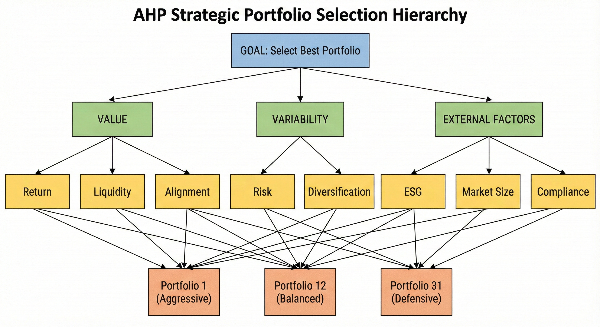

::: {.project-links}
[<i class="bi bi-github"></i> Codice su GitHub](https://github.com/massimilianoganci/NOME-REPO-PORTFOLIO){.btn-proj-primary target="_blank"}
[<i class="bi bi-file-earmark-pdf"></i> Report Completo (PDF)](/assets/PORTFOLIO/Final_Project.pdf){.btn-proj-secondary target="_blank"}
:::

::: {.exec-summary}
### IN SINTESI:
In questo progetto sviluppo un framework decisionale integrato in due fasi che combina il rigore quantitativo della **Programmazione Lineare Intera Multi-Obiettivo (MOLIP)** con la flessibilità strategica dell'**Analytic Hierarchy Process (AHP)**.

Su un dataset reale di **30 asset azionari** distribuiti in **6 settori** (2 anni di serie storiche, 504 giorni di trading), il modello genera la Frontiera di Pareto esatta e classifica le migliori alternative tramite valutazione multicriterio e analisi di sensitività.

**I Risultati chiave:**

* **Frontiera di Pareto esatta** (44 soluzioni): l'algoritmo *$\varepsilon$-Constraint* risolto con il solver **COIN-OR Branch-and-Cut (`CBC`)** sotto vincoli di budget (**1.000 \$**) e rischio massimo (**2.000 MAD**) identifica 44 portafogli non dominati, con netta prevalenza dei settori **Consumer (65,9%)** e **Finance (52,3%)**, mentre **Energy** non compare mai **(0%)**.

* **Impatto della diversificazione ($N \ge 3$):** il modello non vincolato concentra il capitale su un solo titolo (**GE**, iterazione 21); introducendo il vincolo di almeno 3 asset, le iterazioni **12** (`BAC, WMT, GE`, rendimento **263,14 \$**) e **14** (`PFE, WMT, GE`, rendimento **246,47 \$**) raggiungono lo *sweet spot* (~80% del rendimento massimo con ~30% di rischio in meno).

* **Portfolio Bilanciato Vincitore:** classificando tre candidati Pareto-ottimali ($P_1$ Aggressivo, $P_{12}$ Bilanciato, $P_{31}$ Difensivo) su **3 macro-criteri e 8 sub-criteri**, il portafoglio bilanciato **$P_{12}$** prevale nettamente con uno score globale del **52,82%** (contro 24,75% di $P_{31}$ e 22,43% di $P_1$).
* **Robustezza alla sensitività:** variando dinamicamente i pesi dei macro-criteri, $P_{12}$ domina $P_1$ nel **100%** degli scenari e supera $P_{31}$ nel **65%** degli scenari su *Value* e nel **69%** su *Variability*.

**Strumenti utilizzati:** `Python`, `yfinance`, `PuLP / COIN-OR CBC`, `NumPy`, `Pandas`, `Matplotlib`.
:::

---

## Il problema: selezione del portafoglio e trade-off rischio-rendimento

Nel *Project Portfolio Management*, a differenza dell'allocazione finanziaria frazionaria classica, le decisioni di investimento hanno natura binaria: ogni progetto o asset candidato $i \in \{1, \dots, n\}$ può essere interamente selezionato ($x_i = 1$) oppure escluso ($x_i = 0$). Il problema assume quindi la struttura di un **Binary Knapsack Problem multi-obiettivo**, in cui occorre bilanciare la massimizzazione del **Rendimento Totale atteso** e minimizzare l'**Esposizione Totale al Rischio** andando a rispettare i vincoli di budget e di tolleranza al rischio.

In un contesto multi-obiettivo non esiste un'unica soluzione ottima in senso assoluto, ma un insieme di soluzioni non dominate (**Frontiera di Pareto**), in cui nessun obiettivo può essere migliorato senza peggiorare l'altro. Per risolvere sia la complessità combinatoria sia il dilemma della scelta finale tra soluzioni matematicamente equivalenti sulla frontiera, il lavoro integra due metodologie complementari:

1. **Fase quantitativa (MOLIP + $\varepsilon$-Constraint):** filtra lo spazio combinatorio ($2^{30}$ combinazioni possibili) estraendo il nucleo esatto di portafogli Pareto-ottimali.
2. **Fase qualitativa-strategica (AHP):** applicata *a posteriori* su una rosa ristretta di portafogli efficienti, permette di incorporare preferenze decisionali, giudizi esperti e fattori non puramente numerici (come liquidità, conformità normativa ed ESG).

---

## Dati di mercato e parametrizzazione degli asset

Per costruire un banco di prova realistico sono stati estratti da **Yahoo Finance** (tramite la libreria Python `yfinance`) i dati storici di **30 titoli azionari** lungo un orizzonte di **2 anni** (**504 giorni di trading**, $t = 1, \dots, 504$), suddivisi in **6 settori economici**: *Tech* (10), *Consumer* (7), *Finance* (5), *Healthcare* (4), *Energy* (2) e *Industrial* (2). Questa classificazione consente di verificare se portafogli più prudenti tendano a privilegiare settori difensivi rispetto a comparti più volatili.

Per ciascun asset $i$ sono stati definiti tre parametri annualizzati su 252 giorni lavorativi:

* **Costo ($w_i$):** ultimo prezzo di chiusura registrato nella serie storica.
* **Rendimento Atteso ($r_i$):** rendimento percentuale giornaliero medio $R_{i,t}$ annualizzato e convertito in valore monetario:
  $$
  r_i = \left(\frac{1}{T}\sum_{t=1}^{T} R_{i,t}\right) \cdot 252 \cdot w_i
  $$
* **Risk Score ($k_i$):** *Mean Absolute Deviation* (**MAD**) annualizzata in termini monetari — uno score di 1.000 implica una fluttuazione cumulativa media di 1.000 \$ rispetto al trend medio annuo:
  $$
  k_i = \left(\frac{1}{T}\sum_{t=1}^{T} \left|R_{i,t} - \overline{R}_i\right|\right) \cdot 252 \cdot w_i
  $$

| Settore | Costo medio ($w_i$, \$) | Rendimento atteso medio ($r_i$, \$) | Risk Score medio ($k_i$, MAD) |
| :--- | :---: | :---: | :---: |
| **Industrial** | 445,82 | **211,54** | 1.459,39 |
| **Finance** | 441,75 | 150,96 | 1.153,04 |
| **Tech** | 230,54 | 77,14 | 836,71 |
| **Consumer** | 242,92 | 29,80 | 552,82 |
| **Energy** | 133,76 | 12,71 | **339,95** |
| **Healthcare** | 165,36 | 0,01 | 492,60 |

Le statistiche descrittive evidenziano già una chiara polarizzazione settoriale: **Healthcare** ed **Energy** offrono i profili di rischio più bassi ma con rendimenti medi molto modesti, mentre **Industrial** e **Finance** presentano il potenziale di rendimento più elevato a fronte di una volatilità nettamente superiore.

---

## Metodologia integrata: Ottimizzazione MOLIP e AHP

### 1. Fase quantitativa: Binary Knapsack ed $\varepsilon$-Constraint 

Adottando funzioni obiettivo lineari, il modello bi-obiettivo viene riformulato tramite il **metodo $\varepsilon$-Constraint**: a ogni iterazione $j$ si massimizza il rendimento totale imponendo un tetto decrescente $\varepsilon_j$ sul rischio cumulato, risolvendo il sottoproblema $\mathcal{P}(\varepsilon_j)$:

$$
\max \sum_{i=1}^{30} r_i x_i \qquad \text{soggetto a} \qquad
\begin{cases}
\sum_{i=1}^{30} w_i x_i \le W_{\max} = 1.000 \, \$ \\
\sum_{i=1}^{30} k_i x_i \le \varepsilon_j \le R_{\max} = 2.000 \\
x_i \in \{0, 1\} \quad \forall i = 1, \dots, 30
\end{cases}
$$

Poiché l'enumerazione esaustiva di $2^{30}$ combinazioni è computazionalmente impraticabile, ogni istanza è risolta all'ottimo globale tramite il solver **COIN-OR Branch-and-Cut (`CBC`)**, che esplora l'albero delle soluzioni potando i rami sub-ottimali tramite rilassamenti lineari. La procedura parte massimizzando il solo rendimento (Step 0) e restringe progressivamente $\varepsilon_j$ strettamente al di sotto del rischio ottenuto all'iterazione precedente fino a esaurire le soluzioni ammissibili.

### 2. Fase decisionale: Analytic Hierarchy Process (AHP)

Per ordinare i portafogli Pareto-ottimali selezionati secondo preferenze strategiche strutturate, è stato implementato un **AHP a due livelli** composto da **3 macro-criteri** e **8 sub-criteri**:

{fig-align="center" width="80%"}

A partire dalle matrici di confronto a coppie $A = (a_{ij})$ compilate sulla **scala di Saaty (1–9)**, i vettori di priorità normalizzati $w$ sono ottenuti risolvendo il problema agli autovalori $A w = \lambda_{\max} w$, mentre i punteggi globali delle alternative derivano dall'aggregazione lineare pesata $S(a_i) = \sum_k w_k \, s_k(a_i)$. Infine, per testare la tenuta del ranking rispetto alla soggettività dei giudizi, è stata condotta una **sensitivity analysis dinamica** facendo variare l'intero intervallo dei pesi dei tre macro-criteri.

---

## Risultati finali

### 1. Frontiera di Pareto, dominanza settoriale e vincolo di diversificazione

L'algoritmo $\varepsilon$-Constraint genera esattamente **44 portafogli Pareto-ottimali**, che spaziano dal portafoglio a massimo rendimento (`Iter 1: JPM, PFE, GE` con rendimento **322,53 \$** e rischio **1.959,19**) fino al portafoglio difensivo minimo (`Iter 44: PFE` con rendimento **0,90 \$** e rischio **72,93**).

Analizzando la frequenza dei settori lungo le 44 soluzioni efficienti emergono due titoli pilastro — **GE Aerospace (`GE`)** e **Walmart (`WMT`)** — e una chiara gerarchia settoriale: **Consumer** compare nel **65,9%** dei portafogli (29/44), **Finance** nel **52,3%** (23/44), **Industrials** nel **47,7%** (21/44), **Tech** nel **43,2%** (19/44) e **Healthcare** nel **36,4%** (16/44), mentre **Energy** viene completamente dominato (0%).

| Scenario | Criterio di Selezione | Iterazione | Composizione | Rendimento (\$) | Rischio (MAD) | Valore Metrica |
| :--- | :--- | :---: | :--- | :---: | :---: | :---: |
| **Senza vincolo** | Min Distance & Max Efficiency | **21** | `GE` | 198,28 | 1.058,81 | Dist: 0,6499 / Eff: 0,1873 |
| **Senza vincolo** | Max Utility ($\lambda = 0,10$) | **2** | `JPM, GE` | 321,63 | 1.886,27 | Util: 133,00 |
| **Senza vincolo** | Max Utility ($\lambda = 0,15$) | **15** | `WMT, GE` | 245,57 | 1.323,38 | Util: 47,06 |
| **Diversificato ($N \ge 3$)** | **Max Efficiency & Util ($\lambda = 0,15$)** | **12** | `BAC, WMT, GE` | **263,14** | **1.475,39** | **Eff: 0,1784** |
| **Diversificato ($N \ge 3$)** | **Min Distance** | **14** | `PFE, WMT, GE` | **246,47** | **1.396,31** | **Dist: 0,6801** |
| **Diversificato ($N \ge 3$)** | Max Utility ($\lambda = 0,01$) | **1** | `JPM, PFE, GE` | 322,53 | 1.959,19 | Util: 302,94 |

Senza vincoli di cardinalità, sia la minima distanza sia la massima efficienza selezionano il singolo titolo `GE` (iterazione 21, corrispondente al salto verticale più ampio sulla frontiera). L'introduzione del vincolo di diversificazione ($N \ge 3$) elimina il rischio di concentrazione spostando l'ottimo sulle **iterazioni 12 e 14**, che catturano circa l'**80% del rendimento massimo** abbattendo il rischio di quasi il **30%**.

### 2. Ranking decisionale tramite Analytic Hierarchy Process (AHP)

Dalla frontiera diversificata sono stati selezionati tre profili rappresentativi da sottoporre alla valutazione AHP:

* **$P_1$ — Aggressivo (`Iter 1`):** `[JPM, PFE, GE]` — orientato alla massimizzazione del rendimento.
* **$P_{12}$ — Bilanciato:** profilo intermedio centrato sul trade-off rendimento/rischio (`WMT`, `GE` + componente difensiva/finanziaria).
* **$P_{31}$ — Difensivo (`Iter 31`):** `[CSCO, BAC, WMT]` — focalizzato sul contenimento del rischio (rendimento **86,34 \$**, rischio **595,26**).

L'immagine di seguito evidenzia la vittoria netta del portafoglio bilanciato, dopo l'aggregazione dei pesi globali.

.png){fig-align="center" width="70%"}

### 3. Analisi di sensitività e dominanza del ranking

Per verificare che la scelta di $P_{12}$ non dipenda in modo fragile da una singola combinazione di pesi soggettivi, è stata condotta una **sensitivity analysis** variando il peso di ciascun macro-criterio da $0$ a $1$ e misurando la percentuale di dominanza a coppie tra i portafogli:

| Macro-Criterio variato (*Sweep*) | Dominanza $P_{12}$ su $P_1$ | Dominanza $P_{12}$ su $P_{31}$ | Dominanza $P_{31}$ su $P_1$ |
| :--- | :---: | :---: | :---: |
| **Value** *(peso base = 0,74)* | **100%** | **65%** | 77% |
| **Variability** | **100%** | **69%** | 88% |
| **External Factors** | **100%** | 47% | 94% |

I grafici di sensitività evidenziano un risultato strutturale molto chiaro:

* **$P_{12}$ (Balanced) domina strettamente $P_1$ nel 100% degli scenari** su tutti e tre i macro-criteri, risultando l'opzione più robusta nell'intero intervallo realistico di preferenze.
* **$P_{31}$ (Defensive)** supera $P_{12}$ solo in scenari estremi — ossia quando il peso di *External Factors* supera la metà della decisione (53% di dominanza complessiva) oppure quando il peso di *Value* scende sotto ~0,35 — ma viene penalizzato fortemente rispetto al criterio principale (*Value*).
* **$P_1$ (Aggressive)** si conferma strategicamente fragile: non raggiunge mai la prima posizione in nessuno degli scenari e supera persino $P_{31}$ soltanto quando il peso attribuito a *Value* supera ~0,77 (23% dello sweep).

.png){fig-align="center" width="80%"}

### 4. Conclusioni e valore manageriale del framework

Il progetto dimostra l'efficacia di un approccio **ibrido quantitativo–decisionale** nel *Project Portfolio Management*:

* La **Programmazione Lineare Intera Multi-Obiettivo (MOLIP)** tramite *$\varepsilon$-Constraint* elimina le combinazioni inefficienti e garantisce soluzioni matematicamente ottimali, ma da sola restituisce decine di portafogli formalmente equivalenti e rischia di favorire allocazioni eccessivamente concentrate senza vincoli espliciti di diversificazione.
* L'**Analytic Hierarchy Process (AHP)**, applicato a valle del filtraggio di Pareto e validato tramite *sensitivity analysis*, risolve il dilemma decisionale integrando governance, sostenibilità (ESG) e tolleranza al rischio, individuando in **$P_{12}$ (Balanced)** il compromesso più stabile e difendibile (score globale **52,82%**).

In ottica di estensione futura, il framework può essere facilmente arricchito introducendo vincoli di diversificazione settoriale massima, metriche di rischio non lineari (es. covarianza o CVaR) e giudizi AHP aggregati da un panel multi-decisore con verifica esplicita del *Consistency Ratio* (CR).
