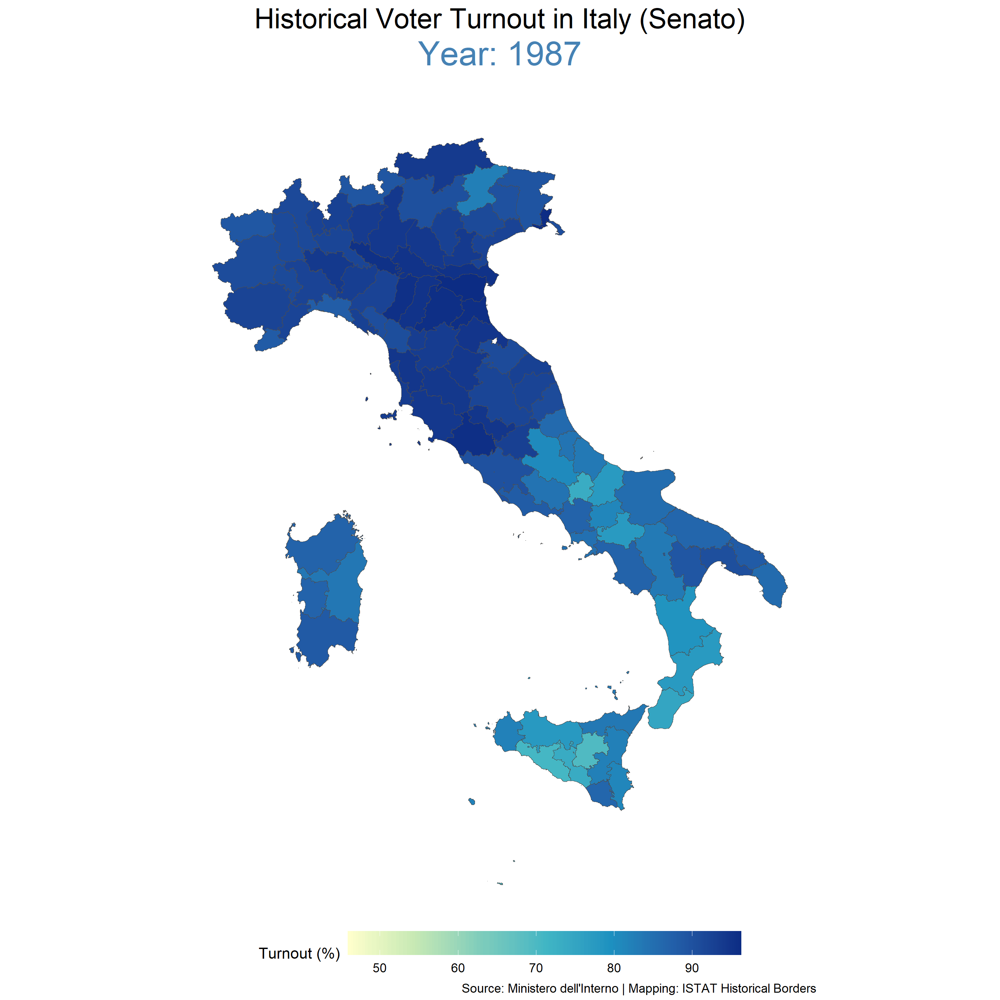
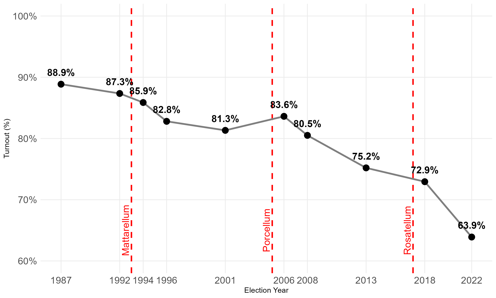
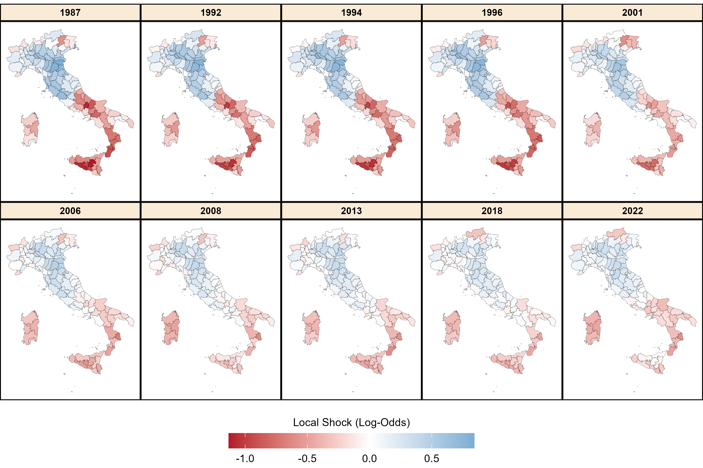
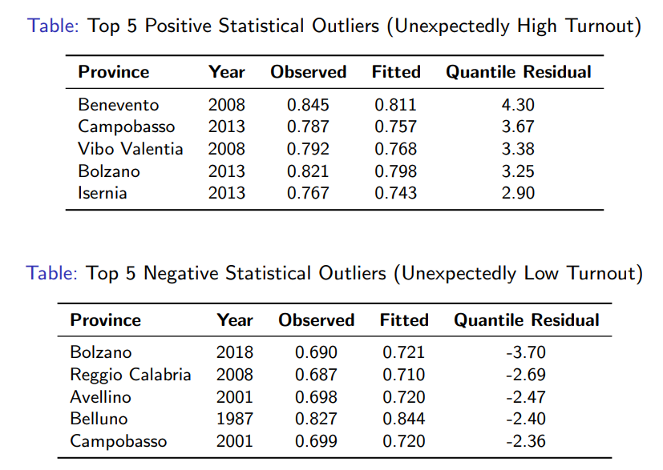

::: {.project-links}
[<i class="bi bi-github"></i> Codici su Repo GitHub](https://github.com/massimilianoganci/Spatiotemporal-model-for-voter-turnouts-with-R-INLA){.btn-proj-primary target="_blank"}
[<i class="bi bi-file-earmark-pdf"></i> Tesi (PDF)](/assets/ABSTENTIONISM/GANCI_thesis.pdf){.btn-proj-secondary target="_blank"}
:::

::: {.exec-summary}
### IN SINTESI:

Tra il **1987 e il 2022** l'affluenza alle elezioni politiche italiane ha registrato un calo nazionale del **24%**, toccando nel 2022 il minimo storico del **63,9%** (circa **17 milioni di astensionisti**). In questa tesi magistrale sviluppo un **modello gerarchico bayesiano spazio-temporale** stimato con `R-INLA` su una serie storica di **107 province** lungo **10 tornate elettorali**, combinando i dati del Ministero dell'Interno (*Eligendo*) con indicatori socio-economici ISTAT.

**I risultati chiave:**

* **Modello ottimale (Knorr-Held Tipo IV):** il modello Beta-logit con interazione spazio-temporale strutturata ($\text{ICAR} \times \text{AR1}$) raggiunge il miglior adattamento (`WAIC = -6666.74`) ed è l'unico a rimuovere simultaneamente l'autocorrelazione spaziale e temporale residua (test *Average Moran's I* e *Lag-1 Correlation*).
* **Driver socio-economici robusti:** il **Tasso di occupazione** esercita un forte effetto positivo (**+11,6%** negli *odds* di voto per ogni deviazione standard), mentre la **Densità di popolazione** ha un lieve effetto negativo (**-3,9%**). Indice di vecchiaia e istruzione risultano invece non robusti nel modello completo.
* **Omogeneizzazione del disimpegno:** la dinamica spazio-temporale mostra il passaggio da shock locali pronunciati nelle prime tornate a una condizione strutturale diffusa sull'intero territorio nazionale.
* **Efficienza computazionale:** sul modello completo di Tipo IV, **`R-INLA` converge in 120 secondi** contro quasi **4 ore** richieste da un'implementazione MCMC/HMC in `brms`.

**Strumenti utilizzati:** `R`, `R-INLA`, `brms`, `tidyverse`, `sf`, `spdep`, `ggplot2`, `GitHub`.
:::

---

## Il fenomeno: crescita del disimpegno politico

L'affluenza elettorale in Italia ha subito un declino strutturale: durante la Prima Repubblica (1948–1992), il sistema proporzionale e la forte polarizzazione bipartitica mantenevano la partecipazione stabilmente tra l'85% e il 90%. La successiva stagnazione istituzionale e il passaggio a sistemi misti e maggioritari (Mattarellum, Porcellum e Rosatellum), più orientati alla governabilità che alla rappresentatività, hanno alimentato una crescente disaffezione, culminata nel 2022 con il **minimo storico del 63,9%** con circa **17 milioni di astenuti**.

Questa ricerca indaga l'evoluzione dell'astensionismo italiano integrando **spazio e tempo** come componenti strutturali e individuando i driver socio-economici utili a spiegare il fenomeno. L'obiettivo principale della tesi è valutare in che modo le differenze spaziali intrinseche del territorio italiano si siano evolute nel corso del tempo, dimostrando se, una volta isolati esclusivamente gli effetti spazio-temporali, persista ancora una forte distinzione tra Nord e Sud nell'affluenza al voto.

---

## La costruzione del database da fonti ufficiali

La fase preliminare, ha riguardato la costruzione di un database spazio-temporale armonizzato a livello provinciale, riallineando tutte le 107 province italiane ai confini del 2022 lungo le 10 elezioni politiche per la Camera dei Deputati svoltesi tra il 1987 e il 2022.

| Componente | Fonte Ufficiale | Dettaglio e Trattamento |
| :--- | :--- | :--- |
| **Affluenza elettorale** | Ministero dell'Interno (*Eligendo*) | Proporzione di votanti per provincia sulle 10 tornate (1987–2022) |
| **Covariate socio-economiche** | ISTAT & archivio storico *8milacensus* | *Densità di popolazione*, *Indice di vecchiaia*, *Incidenza dell'istruzione*, *Tasso di occupazione* (standardizzate) |
| **Geografie e confini** | Shapefile storici ISTAT | Armonizzazione ai 107 confini provinciali del 2022 e ricostruzione delle lacune storiche iniziali |

L'analisi esplorativa preliminare (**EDA**) mette in luce un **calo del 24%** dell'affluenza nazionale lungo il periodo osservato, confermando una frattura persistente tra un Centro-Nord storicamente più partecipativo e un Mezzogiorno segnato da un disimpegno profondo. Inoltre, l'EDA evidenzia come modelli di regressione semplici incorrerebbero in confondimento temporale, giustificando l'adozione architettura spazio-temporale complesse.

::: {.panel-tabset}

### Evoluzione territoriale 
{fig-align="center" width="85%"}

### Trend nazionale (1987-2022)
{fig-align="center" width="85%"}

:::

---

## Modello Gerarchico Bayesiano usando INLA

Come variabile dipendente è stata scelta la proporzione provinciale di affluenza $y_{it} \in (0, 1)$, modellata tramite una **distribuzione Beta** con funzione di legame *logit*, così da modellare direttamente i *log-odds* della partecipazione attesa $\mu_{it}$. I test preliminari hanno confermato che una Binomiale standard sul conteggio grezzo dei votanti risulta inadeguata, poiché i suoi vincoli rigidi sulla varianza non riescono ad assorbire l'elevata sovradispersione dei dati elettorali aggregati.

Per stimare un'architettura così riccamente parametrizzata è stata utilizzata l'**Integrated Nested Laplace Approximation (INLA)**, un'alternativa deterministica e computazionalmente efficiente ai metodi MCMC sviluppata per i *Latent Gaussian Models* (LGM). La struttura gerarchica si articola in tre stadi — verosimiglianza dei dati osservati, campo latente modellato come *Gaussian Markov Random Field* (GMRF) e distribuzioni *a priori* sugli iperparametri — sfruttando l'approssimazione di Laplace (espansione di Taylor del secondo ordine attorno alla moda), una ricerca su griglia non parametrica e l'approccio *Simplified Laplace* per ottenere le distribuzioni marginali a posteriori.

Il predittore lineare è formulato come un modello **STAR** (*Structured Additive Regression*):

$$
\text{logit}(\mu_{it}) = \beta_0 + \sum_{k=1}^{4} \beta_k X_{itk} + \gamma \, D_t + u_i + v_t + \delta_{it}
$$

dove:

* $\beta_0$ è l'intercetta globale, $X_{itk}$ sono le quattro covariate socio-economiche standardizzate, mentre $D_t$ è una variabile *dummy* per il sistema elettorale in vigore
* **$u_i$ (Struttura spaziale `BYM2`):** definita su un grafo di contiguità *Queen* di primo ordine. La specifica **BYM2** combina rumore indipendente non strutturato e una componente strutturata **ICAR** (*Intrinsic Conditional Autoregressive*) riscalata
* **$v_t$ (Struttura temporale `OU`):** il trend temporale è modellato come processo stocastico continuo di **Ornstein-Uhlenbeck (OU)**, in cui la correlazione decade esponenzialmente con la distanza cronologica esatta tra le elezioni
* **$\delta_{it}$ (Interazione spazio-temporale):** cattura le traiettorie locali specifiche di ciascuna tornata elettorale

### Selezione e diagnostica del modello

Sono state confrontate diverse specifiche spazio-temporali, valutandole mediante **WAIC** e analisi dei residui.

Il *Modello 4*, caratterizzato da un'interazione di **Knorr-Held di Tipo IV**, ha ottenuto il miglior adattamento complessivo (**`WAIC = -6666.74`**) ed è risultato l'unico modello capace di eliminare simultaneamente sia l'autocorrelazione spaziale sia quella temporale.

---

## Risultati finali

### 1. Driver socio-economici robusti

L'analisi di sensitività sulle stime a posteriori del *Modello 4* permette di isolare i fattori socio-economici stabili rispetto a quelli dipendenti dalla specificazione del modello:

| Covariata (standardizzata) | Effetto sugli *odds* di voto| Significatività (CI 95%) |
| :--- | :--- | :--- |
| **Tasso di occupazione** | **+11,4%** | Robusto e positivo |
| **Densità di popolazione** | **-3,9%** | Robusto e lievemente negativo |
| **Indice di vecchiaia** | Include lo zero | Non robusto |
| **Incidenza dell'istruzione** | Include lo zero | Non robusto|

### 2. Effetti latenti, omogeneizzazione e anomalie territoriali

* **Trend nazionale (OU) ed effetto spaziale puro (BYM2):** il processo continuo OU mostra elevata volatilità e intervalli di credibilità ampi, segnalando che il solo trend nazionale fatica a spiegare la varianza temporale. Poiché l'interazione spazio-temporale assorbe gran parte delle variazioni locali nel tempo, l'effetto spaziale BYM2 isola le differenze geografiche permanenti: restano evidenti il divario strutturale Nord-Sud e marcate deviazioni negative nelle realtà autonome di **Trento, Bolzano e Aosta**.
* **Omogeneizzazione del disimpegno (Knorr-Held Tipo IV):** mappando l'interazione spazio-temporale lungo i 35 anni del panel si osserva una progressiva attenuazione degli shock localizzati verso deviazioni prossime allo zero nelle tornate più recenti, segno che l'astensionismo si è trasformato in una condizione strutturale diffusa a livello nazionale.
* **Anomalie dai residui PIT:** la provincia autonoma di **Bolzano** emerge come outlier altamente volatile (riflesso della propria specificità etno-linguistica rispetto ai trend nazionali), mentre scostamenti estremi in province meridionali quali **Benevento, Campobasso e Reggio Calabria** segnalano mobilitazioni o defezioni improvvise fuori dalle attese strutturali.

::: {.panel-tabset}

### Interazione Spaziotemporale
  
  
### Province Anomale
  

:::

### 3. Benchmark computazionale (INLA vs MCMC)

Sul piano computazionale, il confronto sullo stesso modello complesso di Tipo IV con un'implementazione **MCMC** (*Hamiltonian Monte Carlo* tramite `brms`) conferma il vantaggio pratico di INLA su dataset spazio-temporali estesi:

| Metodo di Stima | Algoritmo | Tempo di Esecuzione |
| :--- | :--- | :--- |
| **`R-INLA`** | Approssimazione deterministica di Laplace | **120 secondi** (~2 minuti) |
| **`brms`** | Hamiltonian Monte Carlo (MCMC) | **~4 ore** |

### 4. Sviluppi futuri

I risultati empirici confermano che l'astensionismo elettorale in Italia è un fenomeno fortemente dipendente dallo spazio e **non separabile** tra dimensione spaziale e temporale.

Per estendere ulteriormente l'analisi, futuri sviluppi possono affrontare il *Modifiable Areal Unit Problem* (**MAUP**) testando scale territoriali differenti (comunale o regionale) e integrare questa architettura bayesiana macro con dati individuali da sondaggio, come i questionari **ITANES**, per collegare direttamente i trend geografici strutturali alla psicologia del singolo elettore.